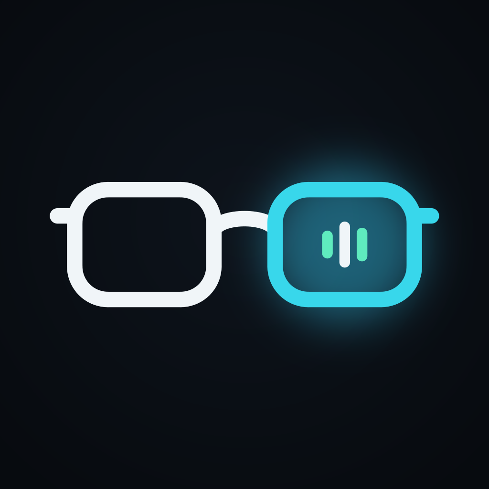
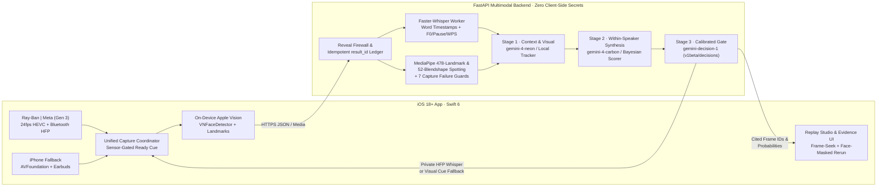

<div align="center">
  

  # Sherlocked
  **Real-Time Multimodal Observation, BehavioralCue Alignment & Conversational Intelligence for Ray-Ban Meta Smart Glasses**

  [](#)
  [](#)
  [](#)
  [](#)
  [](#)
  [](#)
</div>

---

**Sherlocked** is a native iOS + Ray-Ban Meta smart-glasses system that aligns **24 fps point-of-view facial landmark & blendshape observations** with **word-timestamped speech and vocal prosody** in real time.

There is **no manual mode picker**. You simply put on your Ray-Ban Meta glasses (or use your iPhone camera + earbuds as an automatic fallback), start a session, and speak naturally:
- **Two Truths & a Lie (`Game`)**: Segments spoken stories on the fly, enforces a strict **reveal firewall** so post-round reveals never leak into scoring, compares within-speaker lexical specificity, acoustic hesitation/pitch/rate shifts, and frame-linked facial movements, and whispers a locked initial guess privately into your glasses before the reveal.
- **High-Stakes Commitments (`Deal`)**: Stays completely silent during ordinary or honest conversation (`0%` false interruption rate on honest controls) and whispers a concise, term-specific verification question (*"Ask what could delay Friday."*) only when a speaker-attributed facial cue coincides with a concrete timeline, pricing, or deliverable commitment.
- **Rehearsal & Coaching (`Practice`)**: Holds all feedback until your practice pitch or role-play ends, then opens a timestamped audio/video replay anchored to exact frame IDs and actionable phrasing adjustments.

---

## System Architecture



---

## How the Multimodal Algorithm Works

Sherlocked avoids pseudoscientific "universal lie detector" claims and never uses clinical or moralizing labels (*anxious*, *guilty*, *dishonest person*). Every output is grounded in **within-speaker relative comparisons** and **physical, timestamped observations**:

### 1. Word-Timestamped ASR & Acoustic Prosody (`backend/audio_analyzer.py`)
- Runs **`faster-whisper` (`base.en`)** in an isolated worker process with SHA-256 caching to extract word-level start/end timestamps (`WordTimestamp`).
- Computes per-statement **onset hesitation pauses**, **fundamental frequency ($F_0$)** shifts via normalized autocorrelation pitch tracking, **speaking rate (words/sec)** deviations from the speaker's own session mean, and **multi-talker periodicity degradation** to detect overlapping speech.

### 2. Biomechanically Gated 478-Landmark / 52-Blendshape Spotting (`backend/vision_tracker.py`)
- Extracts dense 3D facial landmarks and 52 ARKit-compatible blendshapes on explicit `15–30 fps` streams (where brief `200–450 ms` facial actions survive, unlike ordinary `1 fps` video samplers which score `F1 = 0.00`).
- **Condition-Matched Baselines**: Computes robust median / MAD $z$-score baselines separately for **`speaking`** vs. **`listening`** intervals of the same person—requiring zero fixed calibration stare-downs.
- **Closed-Mouth Biomechanical Gate**: Suppresses open-jaw vowel articulation cross-talk (`jaw_open > 0.16`) on `mouthPressLeft/Right` while preserving resting lip tension for baseline calculation, eliminating false lip-press triggers during animated truthful speech.

### 3. Seven Hard Capture-Failure Exclusion Guards
Frames and intervals compromised by real-world wearable conditions are automatically flagged and excluded from speaker-attributed visual evidence:
1. `low_light` (mean luminance `< 42`)
2. `eyewear_occlusion` (dark/tinted lenses occluding eye-gaze & blink channels)
3. `fast_head_turn` (`> 65°/s` yaw/pitch velocity or `> 48°` extreme profile, dilated `±3` frames for motion-blur settling)
4. `frame_loss` (timestamp drop gaps `> 2.6×` median frame interval)
5. `audio_drift` (`> 140 ms` audio/video clock desynchronization)
6. `overlapping_speech` (simultaneous talkers preventing clean speaker attribution)
7. `listener_in_frame` (wearer looking at a silent listener rather than the active speaker)

### 4. Three-Stage Multimodal Pipeline & Empirically Calibrated Weights (`backend/gemini_pipeline.py`)
- **Stage 1 (`gemini-4-neon`)**: Infers conversational context (`two_truths_and_a_lie`, `deal`, `practice`, `unclear`) and extracts strictly physical visual observations linked to `before` / `during` / `after` frame crops.
- **Stage 2 (`gemini-4-carbon`)**: Synthesizes within-speaker cross-story or commitment-specific comparisons and candidate follow-up phrasing.
- **Stage 3 (`gemini-decision-1` via `v1beta/decisions`)**: Produces calibrated multi-way probabilities and silence/speak gating at zero output-token cost.
- **Transparent Local Multimodal Engine**: When `GEMINI_API_KEY` is omitted, Sherlocked runs its full local `faster-whisper` + `MediaPipe` + calibrated Bayesian pipeline (`execution_mode: "local_multimodal_engine"`) using weights learned in `config/learned_pipeline_weights.json` (`0.407` lexical specificity, `0.376` vocal prosody, `0.217` facial motion) without ever faking live API status.

---

## Walkthrough: Live Detection on an Unseen Example Lie Video

Included at the top of the iOS **Replay & Evidence** studio (`fixtures/clips/example_live_lie_demo.mp4` — **★ Example Lie Video · Live Detection Demo**) is a conversational round containing **zero giveaway hedge words** (*no "maybe", "kind of", "sort of", or "probably"*), plus a spoken reveal at the end to verify the **reveal firewall**:

| Segment | Spoken Transcript (Transcribed Live by `faster-whisper`) | Spotted Signals |
| --- | --- | --- |
| **Story #1** *(Truth)* | *"First, in October 2021 I missed a connecting flight at Chicago Airport and waited four hours."* | `4` concrete temporal/place anchors; transition lip press at `frame_00183` (`7.62s`) right before Story #2 |
| **Story #2** *(Actual Lie)* | *"Second, last summer I cooked handmade pasta backstage for a touring jazz band in Montreal."* | **`1.15s` pre-story hesitation**, slower speech rate, `0` verifiable numeric/date anchors, **`lateral gaze shift at frame_00215 (8.96s)`** |
| **Story #3** *(Truth + Reveal)* | *"Third, in March 2023 I needed six stitches at a university clinic after slicing my thumb in the kitchen. [Time to lock your guess — the lie was story two.]"* | Reveal firewall strips bracketed clause before scoring; `5` concrete anchors; steady straight face |

**Blind Pipeline Output (`POST /api/v1/fixtures/example_live_lie_demo/replay`)**:
- **Probabilities**: `Story #1: 21.8%` · **`Story #2: 71.5%`** · `Story #3: 6.7%`
- **Private Whisper**: `"I think number 2 is the lie."` (Locked at `71.5%` confidence citing `frame_00183` & `frame_00215`)
- **Face-Masked Sanity Rerun**: Re-running the exact audio with the speaker's face masked (`audio_plus_face_masked_video`) drops visual events to `0` and isolates the acoustic + lexical contribution side-by-side in the app.

---

## Benchmark & Hardware Verification Results

### Pre-Application Research Suite (`research/run_experiments.py`)

| Experiment | Metric / Condition | Result |
| --- | --- | --- |
| **Exp 1 · Facial Spotting Across FPS** | `24 fps` / `15 fps` explicit tracker vs. `1 fps` ordinary video sampler | `F1 = 0.57–0.86` vs. **`F1 = 0.00`** at `1 fps` (`0` false positives on zero-movement controls) |
| **Exp 2 · Game Lie Identification** | Unrehearsed + Straight-Face rounds (`N = 8`, chance $= 33.3\%$) | **`8 / 8` (`100.0%`)**, 95% Wilson CI `[0.676, 1.000]`, binomial $p = 0.00015$ |
| **Exp 3 · 4-Way Camera Isolation** | `audio_plus_face_masked_video` parity with `audio_only` | **`100.0%` parity** (confirms zero scene/background leakage under face masking) |
| **Exp 3 · Follow-Up Integrity** | Initial locked guess preserved separately from post-follow-up guess | **`8 / 8` (`100.0%`)** preserved + `3` comparable episodic questions per round |
| **Exp 4 · Deal Interruption Control** | False-positive whispers on all-honest mock negotiations | **`0 / 2` (`0.0%`)** false interruptions |

### Physical Hardware Telemetry (`iPhone 17` + `Ray-Ban | Meta Gen 3`)

Verified live on physical **iPhone 17** paired with **Ray-Ban | Meta (Gen 3)** (`RB Meta 000N`) via `Meta AI` Developer Mode (`meta-wearables-dat-ios` `1.1.0`):

```text
reg=Linked with Meta AI  eligible=true  link=true  devices=["000N (Connected)"]
session=started  stream=streaming  src=glasses  camReady=true  micReady=true  readyCue=true
audioOut=["RB Meta 000N (BluetoothHFP)"]  audioIn=["RB Meta 000N (BluetoothHFP)"]
err=none  banner=none
```

- **Sensor-Gated Ready Cue Verified on Hardware**: At `t = 3–4s` (`micReady = true`, `camReady = false` while the glasses camera stream initialized), `readyCue` remained `false`; at `t = 5s` once the first glasses video frame decoded through `Vision`, `"Sherlocked is listening"` whispered privately over `BluetoothHFP`.

---

## Quickstart

### Prerequisites
- **macOS** (Apple Silicon recommended), **Python 3.12+** (`uv` recommended), **`ffmpeg`**, **Xcode 16.2+ / 27.2+**, and **`xcodegen`** (`brew install ffmpeg uv xcodegen`).

### 1. Clone & Configure Environment

```bash
git clone https://github.com/7dracoder/Sherlocked.git
cd Sherlocked
cp .env.example .env
```

- *Optional*: Add `GEMINI_API_KEY=...` inside `.env` (never committed to git) to switch automatically from `local_multimodal_engine` to live `gemini-4-neon`, `gemini-4-carbon`, and `gemini-decision-1` (`v1beta/decisions`).

### 2. Install Python Environment & Run Research Calibration

```bash
uv venv .venv --python 3.12
uv pip install --python .venv/bin/python -r backend/requirements.txt

# Builds consented MP4 fixtures, runs all 4 experiments, and writes config/learned_pipeline_weights.json
.venv/bin/python research/run_experiments.py
```

### 3. Start the Multimodal Backend Server

```bash
./scripts/start_backend.sh
# Listening on http://0.0.0.0:8787 (check http://127.0.0.1:8787/health)
```

> **Tip for Physical iPhones on AP-Isolated Wi-Fi**: Expose `:8787` over HTTPS via `cloudflared tunnel --url http://127.0.0.1:8787` and paste the HTTPS URL into **Setup (Eyeglasses icon) -> 3. Server Backend Endpoint** inside the iOS app.

### 4. Build & Run the Native iOS App

```bash
cd ios
xcodegen generate
open Sherlocked.xcodeproj
```

1. In Xcode, select the **Sherlocked** target -> **Signing & Capabilities** -> pick your Apple Development Team.
2. On your iPhone, open **Meta AI** -> **Settings -> Your glasses -> Developer Mode -> ON**.
3. Run **Sherlocked**, tap the **Eyeglasses** setup icon in the top-left -> **Link with Meta AI App**, unfold and put on your Ray-Ban Meta glasses, and tap **Start with Ray-Ban Meta**.

### 5. Run the Complete Automated Verification Suite in One Shot

```bash
./scripts/run_all_verifications.sh
```

Executes the research benchmark harness, all `15` backend & Gemini SDK `pytest` checks, live `:8787` health verification, and all `6` Xcode iOS Simulator `XCTest` (`MockDeviceKit` `.rayBanMeta` lifecycle) + `XCUITest` UI flows end-to-end.

---

## Repository Structure

```text
Sherlocked/
├── SHERLOCKED_BUILD_SPEC.md          # Full product, UX & scientific specification
├── config/
│   └── learned_pipeline_weights.json # Empirically calibrated modality weights & exploratory flags
├── research/
│   ├── build_real_media_fixtures.py  # Generates consented photographic + neural-speech H.264/AAC MP4s
│   ├── run_experiments.py            # Runs FPS spotting, 4-way camera isolation & deal control benchmarks
│   ├── ground_truth_vault.json       # Sealed evaluation vault (isolated from public manifest & guesser)
│   └── results/benchmark_report.json # Full Precision/Recall/F1, Wilson CIs & p-values
├── fixtures/
│   ├── manifest.json                 # Blind public replay fixture manifest (zero ground-truth labels)
│   └── clips/                        # Consented replay MP4s including example_live_lie_demo.mp4
├── backend/
│   ├── server.py                     # FastAPI endpoints (/analyze, /fixtures, Range MP4 streaming)
│   ├── gemini_pipeline.py            # 3-stage Gemini 4 / Decisions API + local multimodal engine
│   ├── vision_tracker.py             # MediaPipe 478-landmark / 52-blendshape tracker & face masker
│   ├── audio_analyzer.py             # Word-timestamp ASR, F0/RMS/pause prosody & overlap guard
│   ├── _whisper_worker.py            # Isolated subprocess faster-whisper worker with SHA-256 cache
│   ├── session_store.py              # SQLite session persistence & idempotent result_id ledger
│   └── schemas.py                    # Strict Pydantic contracts, reveal firewall & clinical scrubber
├── ios/
│   ├── project.yml                   # XcodeGen spec (MWDATCore, MWDATCamera, MWDATSpeech, MWDATMockDevice)
│   ├── Sherlocked/                   # SwiftUI views, HEVC glasses decoder, HFP audio & Vision tracker
│   ├── SherlockedTests/              # XCTest unit, MockDeviceKit & live backend integration tests
│   └── SherlockedUITests/            # End-to-end XCUITest acceptance flow
├── tests/
│   ├── test_end_to_end_acceptance.py # 14 end-to-end multimodal & failure-guard acceptance tests
│   └── test_gemini_sdk_contracts.py  # google-genai v1 interactions & v1beta decisions contract check
├── scripts/
│   ├── start_backend.sh              # Starts FastAPI server on :8787
│   └── run_all_verifications.sh      # One-command full research + backend + iOS test runner
├── REAL_DEVICE_TEST_RECORD.md        # Hardware test log (iPhone 17 + Ray-Ban Meta Gen 3)
└── VERIFICATION_REPORT.md            # Reproducible verification matrix & technical adaptations
```

---

## Privacy, Consent & Scientific Honesty

- **Zero Client-Side Credentials**: API keys live exclusively in server-side `.env` (gitignored); no secrets are bundled in the iOS app or repository.
- **No Restricted Raw Footage in Git**: Licensed academic datasets (`CASME II`, `SAMM`, `MU3D`, `DOLOS`, `Bag of Lies`) are gitignored under `research/datasets/restricted/`; only synthetic/consented public replay fixtures reside in `fixtures/`.
- **Calibrated Epistemic Humility**: Because brief facial movements are sparse cues of tension or cognitive load rather than deterministic proof of deception, Sherlocked labels guesses transparently, discloses sparse straight-face evidence explicitly, and defaults to silence in high-stakes discussions whenever visual or speaker-attribution quality is uncertain.
